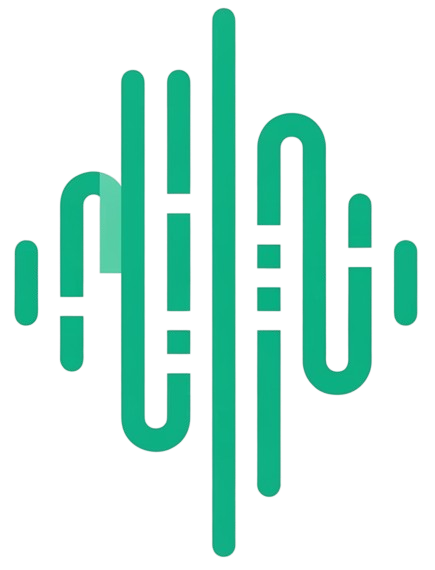
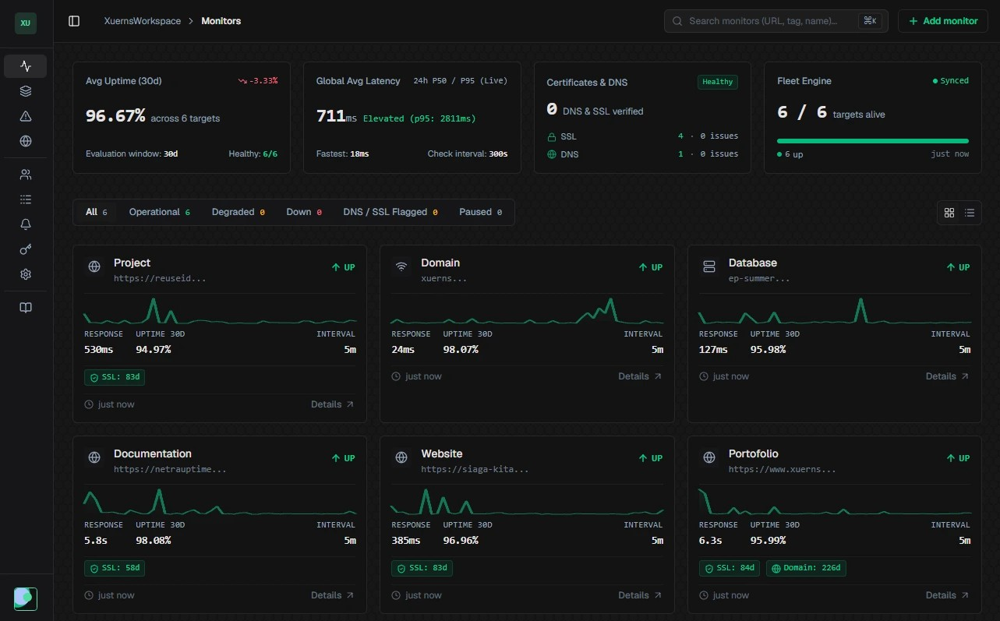

<div align="center">
  <a href="https://netrauptime.dev" target="_blank">
    
  </a>
  <h1 style="border:none; margin-top: 10px; margin-bottom: 6px;">Netra Uptime</h1>
  <p><strong>Modern, Lightweight, Self-Hosted Uptime & Status Monitoring</strong></p>

  <p>
    <a href="https://github.com/Xuerns/Netra-Uptime/actions/workflows/ci.yml"></a>
    <a href="https://go.dev/"></a>
    <a href="https://kit.svelte.dev/"></a>
    <a href="https://github.com/Xuerns/Netra-Uptime/pkgs/container/netra-uptime"></a>
    <a href="LICENSE"></a>
  </p>

  <p>
    <a href="https://netrauptime.dev/docs"><strong>Documentation</strong></a> •
    <a href="#quick-start"><strong>Quick Start</strong></a> •
    <a href="#key-features"><strong>Key Features</strong></a> •
    <a href="#contributing"><strong>Contributing</strong></a> •
    <a href="https://github.com/Xuerns/Netra-Uptime/issues"><strong>Report Issue</strong></a>
  </p>
</div>


## Overview

**Netra Uptime** is a high-performance, open-source uptime monitoring and status page platform designed for self-hosting. Built with a concurrent Go backend worker pool and a reactive SvelteKit interface, Netra Uptime provides low-latency telemetry, automated incident lifecycle tracking, and customizable alert rules.



## Quick Start

You can launch Netra Uptime in less than a minute using either the official CLI runner or Docker Compose.

### Option 1: Instant Run via CLI (Zero-Config)

Run Netra Uptime immediately without cloning using your favorite package runner:

```bash
# npx
npx netra-uptime start
```

### Option 2: Docker Compose (Self-Hosting)

Download the pre-configured production Docker Compose file and start the services:

```bash
# Download docker-compose.prod.yml
curl -fsSL https://raw.githubusercontent.com/Xuerns/Netra-Uptime/main/docker-compose.prod.yml -o docker-compose.yml

# Start containers in detached mode
docker compose up -d
```

Once running, access the dashboard at: **[http://localhost:27346](http://localhost:27346)**.

### Option 3: Windows Desktop Standalone App (Background & System Tray)

Netra Uptime can run on Windows as a native background desktop service with zero external dependencies (pure-Go embedded SQLite, zero CGO):

1. **Build the Desktop Executable:**
   ```powershell
   .\scripts\build-windows.ps1 -Target desktop
   ```
   Or directly with Go:
   ```powershell
   cd server
   go build -ldflags "-H windowsgui -s -w" -o netra-uptime.exe ./cmd/netra-uptime-desktop
   ```
2. **Run:** Double-click `netra-uptime.exe`. It runs completely silently in the background without any command prompt window and places an icon in the Windows System Tray (near the clock).
3. **Controls:**
   - **Click or Right-Click Tray Icon**: Choose **"Open Netra"** to open the dashboard in your default browser (`http://127.0.0.1:27346`).
   - **Right-Click -> "Quit"**: Gracefully stops workers, flushes the SQLite WAL cache, and exits cleanly.
   - **Single-Instance Protection**: Launching the `.exe` again automatically focuses/opens your existing Netra dashboard in your browser and exits.
   - **Silent Startup (e.g. Windows Startup folder)**: Pass `--background` or `--no-browser` to prevent the browser from popping up on login:
     ```cmd
     netra-uptime.exe --background
     ```
   - **Local LAN Monitoring**: When running on SQLite bound to loopback (`127.0.0.1`), private network monitoring is **enabled automatically** (`ALLOW_PRIVATE_NETWORK_MONITORING=true`) so you can monitor local NAS, printers, routers, and homelab services without any extra configuration. For Docker / container deployments, the SSRF guard stays active by default (`false`). You can explicitly set `ALLOW_PRIVATE_NETWORK_MONITORING=true` or `false` in your environment at any time to override.

## Key Features

- **Multi-Protocol Monitoring**: Check uptime via HTTP/HTTPS, TCP ports, and ICMP Ping.
- **SSL Certificate & Domain Expiry**: Proactive tracking of SSL certificate validity and WHOIS/RDAP domain expiration.
- **Concurrent Worker Pool**: Non-blocking scheduler powered by Go goroutines and worker channels.
- **Manual Trigger ("Check Now")**: Run on-demand diagnostic checks directly from the monitor detail dashboard without waiting for cron intervals.
- **Custom Alert Rules & Multi-Channel Notifications**: Fine-grained breach thresholds (consecutive failures, response time limits) with notification dispatchers (Email/SMTP, Slack, Discord, Webhooks).
- **Public & Private Status Pages**: Branded status pages with uptime history bars, maintenance schedules, component grouping, and embeddable SVG badges.
- **Automated Incident Management**: Auto-generation of incident records on downtime, collaborative incident triage updates, and automatic resolution when monitors recover.
- **Multi-Tenancy & Team Roles**: Tenant isolation per organization with role-based access control (`owner`, `admin`, `member`) and email invitations.
- **System Health Checks**: Built-in `/healthz` and `/api/v1/health` endpoints verifying database connectivity for Docker and Kubernetes probes.
- **Public REST API & API Keys**: Secure external automation via rate-limited API keys.

## Contributing

Contributions are always welcome! Please read [CONTRIBUTING.md](CONTRIBUTING.md) for details on setting up your development environment and submitting pull requests.

## License

This project is licensed under the GNU Affero General Public License v3.0 (AGPL-3.0) - see the [LICENSE](LICENSE) file for details.